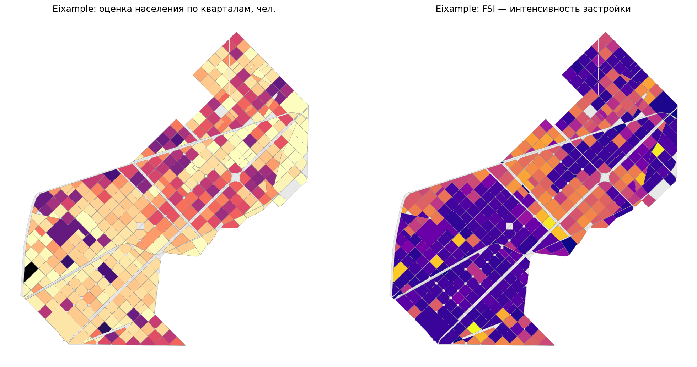

# Urban AI Practice — Barcelona, Eixample

Учебное исследование городских кварталов: от данных OpenStreetMap до интерактивного дашборда
с метриками BlocksNet. Курс «Технологии искусственного интеллекта в урбанистике».

**Территория:** l'Eixample, Barcelona, Catalonia, Spain — 7,5 км², 1 039 кварталов.



## Что получилось

| Показатель | Значение |
|---|---|
| Кварталов всего / застроенных | 1 039 / 437 |
| Площадь территории | 750 га |
| Население (модельная оценка) | 324 283 чел. |
| Мест в школах (оценка) | 15 750 при спросе 39 103 |
| Медианный FSI / GSI | 1,06 / 0,58 |
| Медианное время пешком | 21,5 мин (максимум 36) |
| Кварталов с дефицитом школьных мест | 307 |

## Что в репозитории

| Путь | Что это |
|---|---|
| [`notebooks/practice2_barcelona.ipynb`](notebooks/practice2_barcelona.ipynb) | Ноутбук: план, 12 этапов с картами и пояснениями, выводы, запросы к агенту, инструкция повторного запуска |
| [`dashboard.py`](dashboard.py) | Собирает `dashboard.html` из готовых GeoJSON — без скачивания данных и пересчёта метрик |
| [`dashboard.html`](dashboard.html) | Одна страница: интерактивная карта (6 слоёв), 4 графика, таблицы показателей и выводы |
| `data/*.geojson` | Исходные слои OSM и результаты по кварталам (`blocks_metrics.geojson` — главный) |
| `my_package/`, `tests/`, `docs/` | Шаблон Python-пакета, на котором построен проект |
| `AGENTS.md` | Инструкции для ИИ-агента по работе с проектом |

## Быстрый старт

```powershell
# окружение
py -3.12 -m venv .venv
.\.venv\Scripts\Activate.ps1
pip install -e ".[dev]"
pip install "blocksnet[ipynb,torch]==1.0.0.a9"

# пересчитать ноутбук
python -m jupyter nbconvert --to notebook --execute --inplace notebooks\practice2_barcelona.ipynb

# собрать страницу и открыть
python dashboard.py
start dashboard.html
```

Повторный запуск быстрый: GeoJSON, пешеходный граф и матрица времени кэшируются в `data/`.
Граф и матрица (`*.pkl`) в репозиторий не входят — на чистой копии они строятся заново через `iduedu`
(нужен интернет, 2–4 минуты). `dashboard.py` читает только готовые GeoJSON и работает без них.

## Данные и методика

- **Источник:** OpenStreetMap, выгрузка Geofabrik `cataluna` (19.10.2026). Overpass API в дни работы
  был перегружен, поэтому слои прочитаны из локального `.pbf` через GDAL и обрезаны по границе района.
- **Кварталы:** `blocksnet.blocks.cutting` — территория режется по осям улиц, железным дорогам и воде.
  Границы расчётные и не совпадают с кадастровыми.
- **Пешая доступность:** готовый граф OSM (`iduedu.get_walk_graph`), 5 км/ч, без общественного транспорта.
- **Землепользование:** зоны OSM `landuse` (267 кварталов) + оценка по составу застройки (292 квартала),
  источник помечен в колонке `land_use_source`.
- **Население и вместимость школ** — модельные оценки BlocksNet, а не официальная статистика.

## Ограничения

1. Границы кварталов построены по улицам, а не по кадастру.
2. Население завышено примерно на 20% относительно официальных ≈265 тыс. (норма 30 м²/чел.
   и восстановленная этажность).
3. Вместимость школ — оценка BlocksNet (`impute_services`: 250 мест на школу, 63 × 250 = 15 750): в OSM поле `capacity` почти не заполнено.
4. Доступность пешеходная: метро и автобусы Барселоны не учтены, реальная связность выше.

## Технологии

Python 3.12, BlocksNet 1.0.0a9, GeoPandas, OSMnx, iduedu, Folium, Matplotlib, Jupyter.

## Благодарности

Проект вырос из учебного шаблона
[vasilstar97/python-package-boilerplate](https://github.com/vasilstar97/python-package-boilerplate)
(BSD-3): структура пакета, `pyproject.toml`, тесты и CI сохранены. Вся работа по практике 2 —
ноутбук, данные, метрики и дашборд — выполнена в этом репозитории.
